<p align="center">
  
</p>

<p align="center">
  
  
  
  
  
  <br>
  
  
  
  
  
</p>

<p align="center">
  <b>The investment platform behind <a href="https://buildcaps.vercel.app">Buildcaps Real Estate</a>.</b><br>
  A multilingual Dubai property site, an AI intelligence suite and a complete sales back office:<br>
  listings, off-plan projects, market data, an own booking calendar and a CRM, in one codebase.
</p>

<p align="center">
  <a href="#-at-a-glance"><b>At a glance</b></a> ·
  <a href="#-platform-map"><b>Platform map</b></a> ·
  <a href="#-intelligence-suite"><b>Intelligence</b></a> ·
  <a href="#-architecture"><b>Architecture</b></a> ·
  <a href="#-data-model"><b>Data model</b></a> ·
  <a href="#-security"><b>Security</b></a> ·
  <a href="#-languages"><b>Languages</b></a> ·
  <a href="#-getting-started"><b>Getting started</b></a>
</p>


## ◆ At a glance

<p align="center">
  
</p>

Buildcaps turns Dubai's open property data into decisions. Visitors search in their own language and see each listing with its DLD permit, payment plan and numbers. They can test it against their own finances with the AI tools, then book a meeting in a few clicks. The team runs the whole business from the admin: content, market data, bookings, the sales pipeline and the AI agents.

<p align="center">
  
</p>


## ◆ Platform map

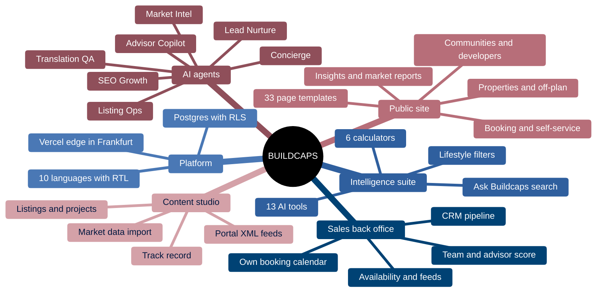


## ◆ What's inside

<table>
  <tr>
    <td width="50%" valign="top">
      <h3>🏙️ Public experience</h3>
      <ul>
        <li><b>Properties and off-plan:</b> every listing with its DLD (Trakheesi) permit, payment plan, yield and surroundings</li>
        <li><b>Communities and developers:</b> prices, yields, schools and transport, plus each developer's verified track record</li>
        <li><b>Ask Buildcaps:</b> natural-language search such as "2-bed near a British school under 2M"</li>
        <li><b>Lifestyle filters:</b> real drive times, schools, metro and monthly cost</li>
        <li><b>Booking:</b> a timezone-aware booking flow, with self-service reschedule and cancel</li>
        <li><b>Insights, market reports and the investor guide</b></li>
      </ul>
    </td>
    <td width="50%" valign="top">
      <h3>🗂️ Sales back office</h3>
      <ul>
        <li><b>CRM:</b> one contact per person. Every enquiry and booking files itself; a drag-and-drop pipeline, tasks, a timeline and CSV export</li>
        <li><b>Own booking calendar:</b> a week view per advisor; staff bookings, reschedule and reassign, all with clash checks</li>
        <li><b>Availability:</b> weekly hours, time off, booking rules and private iCal feeds</li>
        <li><b>Video calls:</b> each advisor's own Zoom, Teams or Meet room, or a free Jitsi room</li>
        <li><b>Content studio:</b> listings, projects, communities, opportunities, articles, reports and careers</li>
        <li><b>Roles:</b> admin, editor and advisor, enforced in the database</li>
      </ul>
    </td>
  </tr>
</table>


## ◆ Intelligence suite

Thirteen AI tools turn open data into answers. Each one runs on Dubai Land Department transactions, OpenStreetMap and our own models, and the AI explains each result in the visitor's language.

| | Tool | What it does |
|:-:|---|---|
| 📈 | **Buildcaps Estimate** | An instant value range for any Dubai property, from DLD transactions |
| 🗺️ | **Dubai Data Room** | Price maps, transactions and community insights, updated from DLD data |
| 🎯 | **Match Me** | Six questions. Your best-fit properties, each with the reason why |
| 💹 | **Wealth Twin** | Your net worth in 5, 10 and 20 years: Dubai versus keeping your money at home |
| 🧭 | **Regret Radar** | What past buyers earned here, and which option you're least likely to regret |
| 🏗️ | **Portfolio Architect** | Splits a budget into a diversified Dubai portfolio balancing growth and income |
| 🚗 | **Day in Your Life** | Your real commute, school run and weekend from any address, in your language |
| 👨‍👩‍👧 | **Family Decision Room** | Decide together from different countries, with live translation and one shortlist |
| 📜 | **Promise Ledger** | What developers promised in their brochures, and what they actually delivered |
| ⏱️ | **Handover Truth Score** | How likely an off-plan project is to hand over on time |
| 👻 | **Ghost Tenant Market** | A simulated market of tenants and buyers predicts rent, vacancy and the best time to sell |
| 🌆 | **Future Skyline View** | Your view today, and in five years once announced towers are built (Three.js + sun path) |
| 🤝 | **Buyer Bloc** | Investors worldwide join forces for block pricing on a new launch |

Six classic calculators cover the rest, with no AI cost: **ROI**, **mortgage**, **payment plan**, **buying costs**, **Golden Visa eligibility** and **currency**.

### Agents that do the work

| Agent | Trigger | What it does | Human control |
|---|---|---|---|
| **Concierge** | Chat or voice on any page | Searches listings, works out costs, checks free slots and hands over a booking link or a WhatsApp brief | The visitor confirms in the booking flow |
| **Listing Ops** | Brochure PDF upload | Reads the brochure and drafts the listing in 10 languages, with keywords and payment plan | Saved as an unpublished draft |
| **Market Intel** | Weekly, and on demand | Refreshes community figures from DLD data and drafts the market note | Posts need approval |
| **Lead Nurture** | New enquiry | Scores the lead and drafts a personal follow-up | An advisor sends it |
| **Advisor Copilot** | Before and after each meeting | Writes the pre-meeting brief, then the summary, tasks and follow-up | The advisor edits |
| **Verified Listing** | On request | Checks listing photos for duplicates, watermarks and mismatches | An editor confirms the badge |
| **SEO Growth** | Weekly | Proposes title, description, FAQ and internal-link changes from Search Console data | Low-risk changes go live with rollback; content needs approval |
| **Translation QA** | On publish | Compares each translation with the English and checks numbers, dates and brand names | Flags only |

Every agent run is logged. AI assistants such as ChatGPT can search listings, check free slots and get a booking link through the Buildcaps **MCP server** (`/api/mcp`).

### Parity with the region's leading portals

| Leading portals offer | Buildcaps answer |
|---|---|
| Bayut **TruEstimate** | **Buildcaps Estimate**: a value range from DLD comparables, explained in plain words |
| Bayut **TruCheck** | **Verified Listing**: an AI photo check plus an advisor's confirmation |
| Property Finder **Data Guru** | **Dubai Data Room**: price map, community insights and transactions |
| Property Finder **SuperAgent** | **Advisor Score**: response time, show rate, verified reviews and deals |
| Zillow commute and school search | **Lifestyle filters**: real drive times, schools and monthly cost |
| Portal apps inside AI assistants | **MCP connector**: search, listing details, costs and booking links for AI assistants |
| Compass AI assistant for agents | **Advisor Copilot**: briefs, summaries, follow-ups and lead scores |


## ◆ Architecture

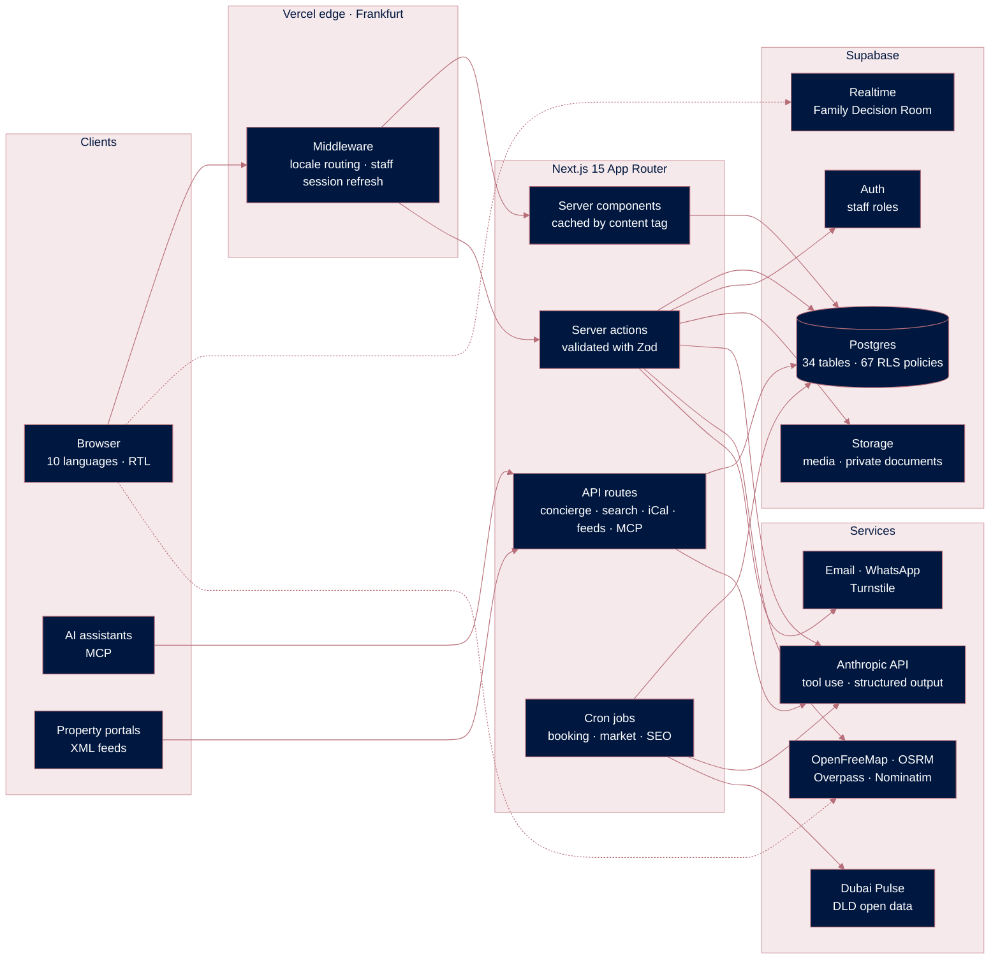

**Design principles**

- **Database-enforced security.** Every staff write runs as the signed-in user, so row-level security enforces their role even if someone bypasses the UI. The service key is used only on the server, for work no session should do directly.
- **Atomic bookings.** `book_appointment()` takes a per-advisor advisory lock, then checks bookings (with buffer) and time off in a single transaction. Double bookings can't happen.
- **Errors staff can act on.** Server actions return their errors instead of throwing, so production builds show "That advisor is busy at that time" instead of a generic failure.
- **Free and open data first.** The maps, routing, places and market data are open. The Anthropic API is the only paid AI service.

### How a booking works

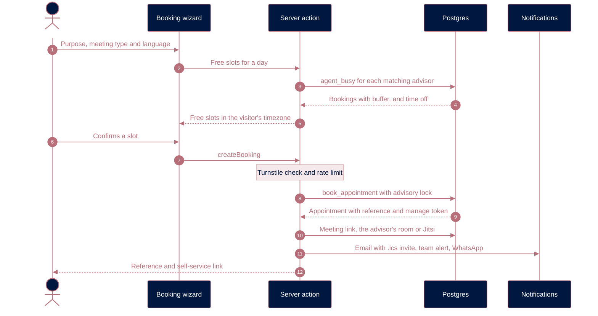

### Sales pipeline

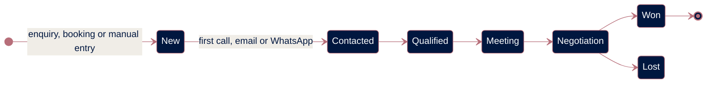


## ◆ Data model

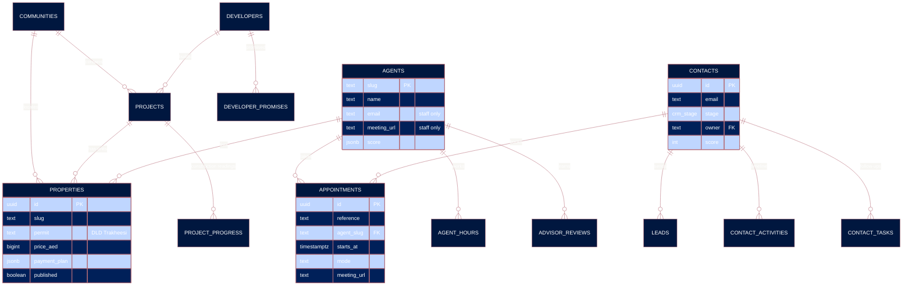

Nine migrations define 34 tables, 23 SQL functions and 67 row-level security policies. Content is stored as localized JSON (`{"en": …, "ar": …}`), so one row serves all ten languages.


## ◆ Security

| Capability | Visitor | Advisor | Editor | Admin |
|---|:-:|:-:|:-:|:-:|
| Read published content | ✅ | ✅ | ✅ | ✅ |
| Send an enquiry or book a meeting | ✅ | ✅ | ✅ | ✅ |
| Read drafts, contacts and bookings | — | ✅ | ✅ | ✅ |
| Update contacts and appointments | — | ✅ | ✅ | ✅ |
| Create and edit listings and content | — | — | ✅ | ✅ |
| Delete, publish SEO changes, manage staff | — | — | — | ✅ |

- **Row-level security on every table.** Visitors can create enquiries but never read them back.
- **Column-level privacy.** Visitors can't see advisors' email addresses or meeting links.
- **Staff-only admin.** Staff accounts are created by an admin, accounts without a staff role get no access, and the last admin can't be removed.
- **Hardened edge.** Strict Content-Security-Policy, HSTS, `frame-ancestors 'none'`, Cloudflare Turnstile and rate limits on public forms.
- **Compliance by design.** A listing can't be saved without a DLD permit, and an off-plan unit can't be listed for rent.


## ◆ Languages

| Language | Code | Direction | Interface coverage |
|---|:-:|:-:|---|
| English | `en` | LTR | `▰▰▰▰▰▰▰▰▰▰` 100% · 1,506 strings |
| العربية | `ar` | **RTL** | `▰▰▰▰▰▰▰▰▰▱` 96% |
| Русский | `ru` | LTR | `▰▰▰▰▰▰▰▰▰▱` 96% |
| 中文 | `zh` | LTR | `▰▰▰▰▰▰▰▰▰▱` 96% |
| हिन्दी | `hi` | LTR | `▰▰▰▰▰▰▰▰▰▱` 96% |
| Français | `fr` | LTR | `▰▰▰▰▰▰▰▰▰▱` 96% |
| Deutsch | `de` | LTR | `▰▰▰▰▰▰▰▰▰▱` 96% |
| Italiano | `it` | LTR | `▰▰▰▰▰▰▰▰▰▱` 96% |
| اردو | `ur` | **RTL** | `▰▰▰▰▰▰▰▰▰▱` 96% |
| فارسی | `fa` | **RTL** | `▰▰▰▰▰▰▰▰▰▱` 96% |

English stays at the root (`/properties`) so old buildcaps.com links keep working. Every other language is prefixed (`/ar/properties`), with `hreflang` alternates and fully mirrored right-to-left layouts. Strings that aren't translated yet fall back to English, and `npm run i18n:check` validates every message's ICU syntax and placeholders.


## ◆ Engineering by the numbers

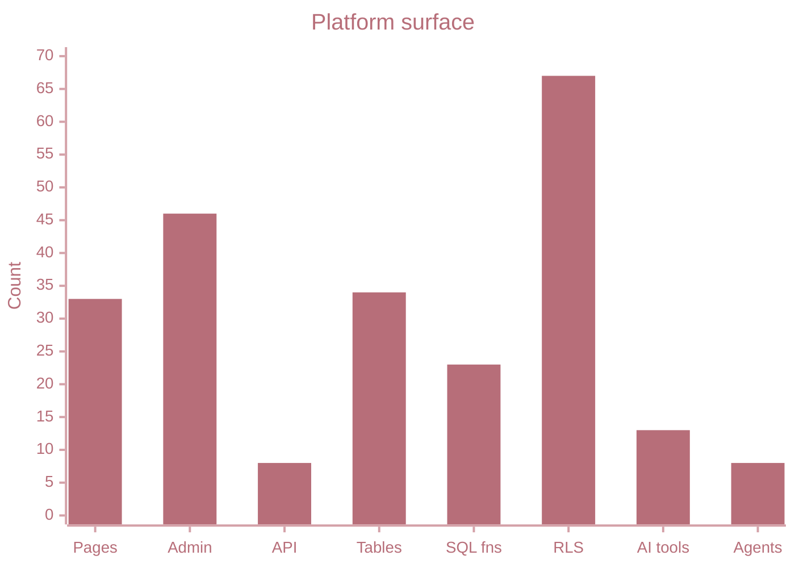

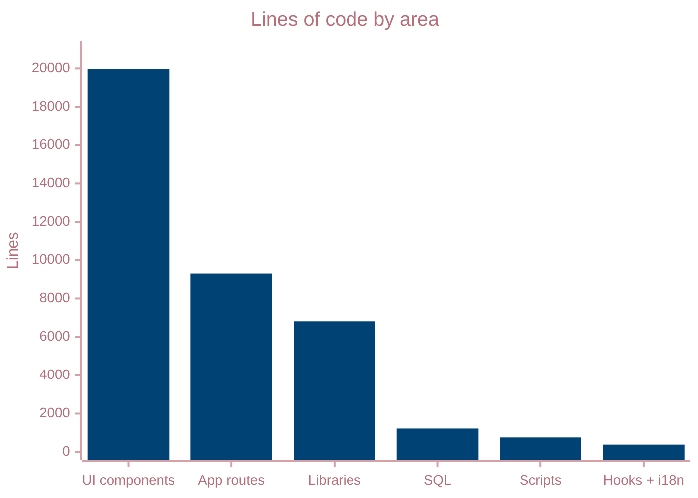

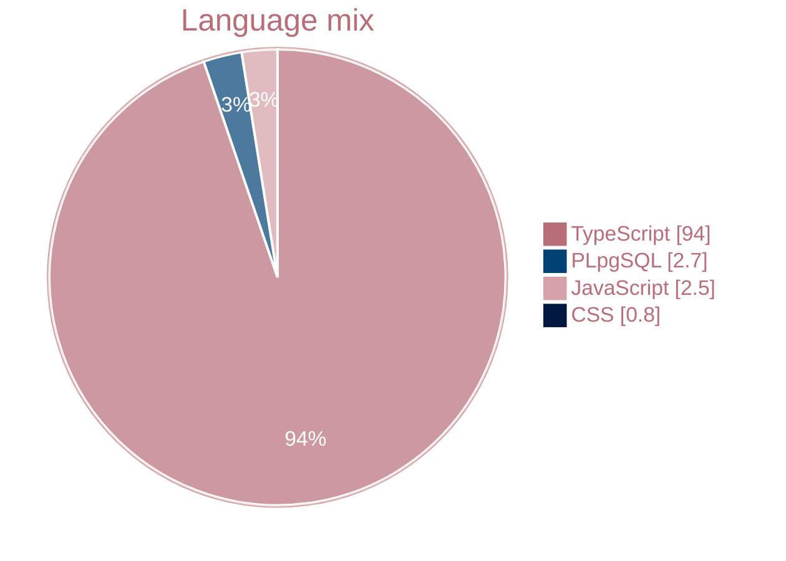

| | |
|---|---|
| **176** React components | **46** admin screens |
| **11** server-action modules | **8** API routes · **3** scheduled jobs |
| **20,718** lines of translations | **9** SQL migrations |


## ◆ Tech stack

| Layer | Technology |
|---|---|
| **Framework** | Next.js 15.5 (App Router, React Server Components, server actions) · React 19 |
| **Language** | TypeScript 5 in strict mode · Zod validation at every boundary |
| **Interface** | Tailwind CSS 4 · Radix UI primitives · Framer Motion · Lenis smooth scrolling · Lucide icons |
| **Internationalisation** | next-intl 4 · 10 locales · right-to-left layouts · localized metadata and `hreflang` |
| **Data** | Supabase: Postgres with row-level security, Auth, Storage and Realtime |
| **AI** | Anthropic API: tool use, structured outputs, PDF and image understanding · MCP server |
| **Maps and 3D** | MapLibre GL with OpenFreeMap tiles · OSRM routing · Overpass places · Three.js · suncalc |
| **Charts** | Recharts |
| **Messaging** | Email by Resend or SMTP with `.ics` invites · WhatsApp Cloud API · Web Speech API |
| **Security** | Cloudflare Turnstile · rate limiting · CSP and HSTS headers |
| **Hosting** | Vercel, Frankfurt region (`fra1`) · Vercel Cron |


## ◆ Roadmap

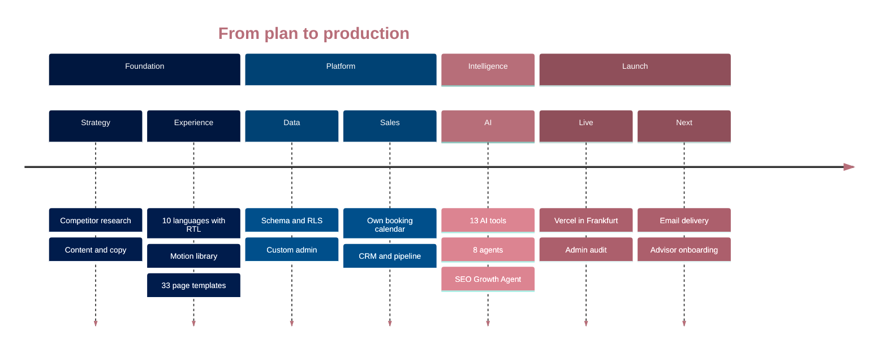

| Milestone | Scope | Status |
|---|---|:-:|
| **M0 – M5** | Setup, research, content, i18n and RTL, motion library, every page | ✅ Done |
| **M6 – M7** | Schema, admin, properties, opportunities, booking flow | ✅ Live |
| **M8 – M10** | Concierge, portal-parity AI, agents, SEO agent, the 13 AI tools | ✅ Built |
| **M11** | Compliance, redirects, analytics, performance, deployment | 🟡 In progress |
| **M12 – M13** | Own booking and CRM, content admin, remaining AI features | ✅ Live |
| **Next** | Email delivery, the listing catalogue, advisor onboarding | 🔜 Planned |


## ◆ Getting started

**Requirements:** Node.js 20 or later, and a Supabase project (the free tier is enough).

```bash
git clone https://github.com/THS001/build-caps-website-and-software-.git
cd build-caps-website-and-software-
npm install
cp .env.example .env.local    # then fill in the values
npm run dev                   # http://localhost:3000
```

Without Supabase keys the site runs on built-in sample data, so you can explore every page right away. The database setup (migrations, first admin, roles) is in [`docs/supabase-setup.md`](docs/supabase-setup.md), and the launch checklist is in [`docs/launch-checklist.md`](docs/launch-checklist.md).

<details>
<summary><b>Environment variables</b></summary>
<br>

| Variable | Needed for |
|---|---|
| `NEXT_PUBLIC_SITE_URL` | Canonical links, sitemap, emails |
| `NEXT_PUBLIC_SUPABASE_URL` · `NEXT_PUBLIC_SUPABASE_ANON_KEY` | Database and staff sign-in |
| `SUPABASE_SERVICE_ROLE_KEY` | Server-only jobs: bookings, AI agents, imports |
| `ANTHROPIC_API_KEY` | AI tools, agents and the Concierge |
| `RESEND_API_KEY` *or* `SMTP_HOST` · `SMTP_PORT` · `SMTP_USER` · `SMTP_PASS` | Booking emails and invites |
| `EMAIL_FROM` · `EMAIL_TEAM` | Sender and internal notifications |
| `NEXT_PUBLIC_TURNSTILE_SITE_KEY` · `TURNSTILE_SECRET_KEY` | Bot protection on forms |
| `CRON_SECRET` | Protects the scheduled jobs |
| `FEED_TOKEN` | Private portal XML feeds |
| `GOOGLE_SERVICE_ACCOUNT_EMAIL` · `GOOGLE_SERVICE_ACCOUNT_KEY` · `GSC_SITE_URL` | Search Console data for the SEO agent |
| `SEO_AGENT_MODE` | `dry_run` or `live` |
| `WHATSAPP_TOKEN` · `WHATSAPP_PHONE_NUMBER_ID` · `WHATSAPP_TEMPLATE` | Optional WhatsApp confirmations |
| `DLD_TRANSACTIONS_CSV_URL` | Optional automatic DLD import |
| `NEXT_PUBLIC_GA_ID` · `NEXT_PUBLIC_CLARITY_ID` · `NEXT_PUBLIC_META_PIXEL_ID` · `NEXT_PUBLIC_TIKTOK_PIXEL_ID` | Analytics, loaded only after cookie consent |

</details>

<details>
<summary><b>Scripts</b></summary>
<br>

| Command | What it does |
|---|---|
| `npm run dev` | Development server |
| `npm run build` · `npm start` | Production build and server |
| `npm run i18n:check` | Validates every translation (ICU syntax, placeholders, unknown keys) |
| `npm run i18n:translate` | Drafts missing translations |
| `npm run admin:create` | Creates the first admin account |
| `npm run admin:password` | Resets an admin password |

</details>

<details>
<summary><b>Project structure</b></summary>
<br>

```text
app/
├─ [locale]/(site)/      Public site: 33 page templates in 10 languages
├─ [locale]/admin/       Staff admin: 46 screens and their server actions
├─ actions/              Public server actions: booking, enquiries, AI tools
└─ api/                  Concierge, search, iCal feeds, portal feeds, MCP, cron jobs
components/
├─ admin/                Admin forms, calendar, CRM and pipeline board
├─ booking/              Booking wizard and self-service
├─ tools/                13 AI tools and 6 calculators
└─ site/ · ui/ · motion/ Site sections, design system and motion primitives
lib/
├─ ai/                   Model client, tool registry and the agents
├─ booking/              Availability, slots, notifications and calendar files
├─ data/                 Content source: Supabase, or sample data before setup
├─ market/ · geo/        DLD ingestion, estimates, routing and surroundings
└─ seo-agent/            Search Console analysis, proposals and rollback
messages/                Interface strings for the 10 languages
supabase/migrations/     Schema, RLS policies and SQL functions
docs/                    Research, content strategy, setup and launch guides
```

</details>

### Deployment

The site deploys to **Vercel** in the Frankfurt region, close to both Dubai and the database. These scheduled jobs run on Vercel Cron:

| Job | Schedule (UTC) | Work |
|---|---|---|
| `/api/cron/booking` | Daily, 05:00 | Reminders, advisor briefs, feedback requests, Advisor Scores |
| `/api/cron/market` | Mondays, 02:00 | DLD import, community figures, the market note, listing surroundings |
| `/api/cron/seo` | Mondays, 03:00 | SEO Growth Agent run |

### Quality gates

```bash
npx tsc --noEmit        # type safety across the whole codebase
npm run i18n:check      # every translation valid in every language
npm run build           # production build
```


## ◆ License

Copyright © 2026 Buildcaps Real Estate LLC. All rights reserved.
This repository is proprietary. No part of it may be copied, modified or distributed without written permission.

<p align="center">
  
</p>
